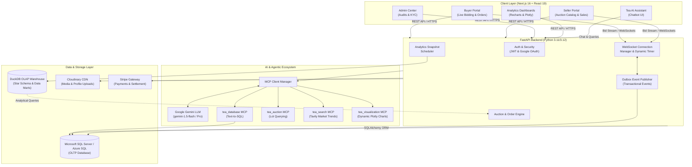

# TeaBlend AI

> **Next-Generation AI Analytics and Real-Time Electronic Auction Platform for the Sri Lankan Tea Industry**

[](https://fastapi.tiangolo.com)
[](https://nextjs.org)
[](https://www.python.org)
[](https://www.typescriptlang.org)
[](https://tailwindcss.com)
[](https://www.docker.com)
[](LICENSE)

---

## Table of Contents

- [The Vision & Project Idea](#the-vision--project-idea)
- [Key Features](#key-features)
  - [1. Real-Time Dynamic Auction Platform](#1-real-time-dynamic-auction-platform)
  - [2. AI Tea Blend Creator](#2-ai-tea-blend-creator)
  - [3. Domain-Specific AI Assistant with MCP Tools](#3-domain-specific-ai-assistant-with-mcp-tools)
  - [4. Kimball Data Warehouse & ELT Analytics](#4-kimball-data-warehouse--elt-analytics)
  - [5. Role-Based Workspaces (Buyer, Seller, Admin)](#5-role-based-workspaces-buyer-seller-admin)
- [System Architecture](#system-architecture)
- [Technology Stack](#technology-stack)
- [Project Directory Structure](#project-directory-structure)
- [Getting Started & Local Setup](#getting-started--local-setup)
  - [Prerequisites](#prerequisites)
  - [1. Environment Configuration](#1-environment-configuration)
  - [2. Database Setup](#2-database-setup)
  - [3. Running Backend Services](#3-running-backend-services)
  - [4. Running Frontend Application](#4-running-frontend-application)
  - [5. Alternative: Running with Docker Compose](#5-alternative-running-with-docker-compose)
- [Health Checks & API Documentation](#health-checks--api-documentation)
- [Contributing & License](#contributing--license)

---

## The Vision & Project Idea

Sri Lanka’s tea industry (world-renowned as **Pure Ceylon Tea**) forms the economic backbone of the nation's agricultural exports. For over a century, the trade has relied heavily on traditional, physically centralized Colombo auctions, manual sensory blending methods, fragmented pricing intelligence, and legacy broker systems.

**TeaBlend AI** transforms this ecosystem into a modern, transparent, and data-driven marketplace. By fusing **real-time WebSocket bidding**, **machine learning tea blend optimization**, **Model Context Protocol (MCP) intelligent agent workflows**, and **high-performance OLAP analytics**, TeaBlend AI empowers:

- **Tea Producers & Estates (Sellers):** Direct cataloging, dynamic live lot auctions, transparent price discovery, and rapid post-auction order fulfillment.
- **Exporters & Blenders (Buyers):** Sub-second live auction participation, AI-recommended flavor formulation, taste profiling, automated order tracking, and integrated Stripe settlements.
- **Brokers & Industry Regulators (Admins):** Complete traceability, user verification (KYC), dispute and violation management, automated bulk CSV ingest, and holistic market auditing.

---

## Key Features

### 1. Real-Time Dynamic Auction Platform
- **Live Bidding via WebSockets:** Sub-second bid broadcast across all connected buyers and sellers.
- **Dynamic Anti-Sniping Timer:** Automated timer extension when bids arrive in the final seconds of a lot to ensure fair market price discovery.
- **Reliable Outbox Pattern:** Guarantees transactional consistency between transactional database updates and real-time WebSocket event dispatching.
- **Order Finalization & Escrow:** Automated winner determination, contract generation, Stripe payment processing, and in-app order messaging.

### 2. AI Tea Blend Creator
- **Sensory & Chemical Taste Matching:** Analyzes elevation profiles (*High Grown, Medium Grown, Low Grown*), leaf grades (*BOP, OP, Pekoe, Dust, etc.*), moisture, and aroma notes to recommend optimal blend recipes.
- **Cost & Yield Optimization:** Helps blenders calculate target blend costs against real-time market prices while preserving taste consistency.
- **Market Demand Alignment:** Recommends blend variations suited to specific international target markets (e.g., Middle East, Europe, North America).

### 3. Domain-Specific AI Assistant with MCP Tools
Built on **Google Gemini** and modern **Model Context Protocol (MCP)** tool microservices:
- **`tea_database` MCP:** Natural language Text-to-SQL converter that translates user questions into safe queries against operational tea catalogs and auction records.
- **`tea_auction` MCP:** Extracts lot parameters and helps buyers monitor and interact with auction items conversationally.
- **`tea_search` MCP:** Web-augmented market intelligence (via Tavily) for global competitor movements, weather impacts, and tea commodity trends.
- **`tea_visualization` MCP:** Dynamically generates interactive charts and Plotly visualizations directly in chat responses.
- **Topic Validator & Intent Classifier:** Ensures conversations remain strictly grounded in tea industry topics.

### 4. Kimball Data Warehouse & ELT Analytics
- **DuckDB-Powered OLAP Store:** Built using Kimball star-schema dimensional modeling (`dim_date`, `dim_tea_grade`, `dim_user`, `dim_tea_blend`, `fact_auction_transactions`, `fact_bids`, and `fact_orders`).
- **Batch ELT & Streaming Processors:** Automated data extraction, transformation, quality checks, and loading pipelines.
- **Automated KPI Snapshot Scheduler:** Powers lightning-fast executive dashboards for price trends, grade volume distribution, seller performance, and buyer demand patterns.

### 5. Role-Based Workspaces (Buyer, Seller, Admin)
- **Buyer Workspace:** Live auction arena, lot catalog with search/filter, bid history, order tracker, saved payment methods, and seller messaging.
- **Seller Workspace:** Auction scheduler, lot creation with custom reserves, live auction status monitor, sales history, and dispatch management.
- **Admin Command Center:** Real-time auction surveillance, user verification & KYC approvals, CSV catalog ingestion, violation handling, and full system audit logs.

---

## System Architecture



---

## Technology Stack

| Domain | Technology | Description |
|---|---|---|
| **Frontend Framework** | [Next.js 16](https://nextjs.org) (App Router) | High-performance React server and client components |
| **Frontend UI & Styling** | [Tailwind CSS v4](https://tailwindcss.com), [Radix UI](https://www.radix-ui.com) | Accessible primitives and responsive styling |
| **Frontend State & Charts**| [Recharts](https://recharts.org), [Plotly.js](https://plotly.com/javascript/), [Framer Motion](https://www.framer.com/motion/) | Interactive data visualization and fluid animations |
| **Backend API** | [FastAPI](https://fastapi.tiangolo.com) | Modern, asynchronous, high-speed Python REST & WebSocket framework |
| **ORM & Migrations** | [SQLAlchemy 2.0](https://www.sqlalchemy.org), [Alembic](https://alembic.sqlalchemy.org) | Enterprise relational mapping and schema version control |
| **Transactional DB (OLTP)** | [Microsoft SQL Server](https://www.microsoft.com/sql-server) / Azure SQL | ACIDs-compliant transactional core for auctions, bids, and users |
| **Analytics DB (OLAP)** | [DuckDB](https://duckdb.org) | In-process columnar database powering Kimball star-schema data marts |
| **AI & LLM Services** | [Google Gemini](https://ai.google.dev), [LangChain](https://www.langchain.com) | Advanced reasoning, chat orchestration, and domain extraction |
| **Agent Protocol** | [Model Context Protocol (MCP)](https://modelcontextprotocol.io) | Tool servers for SQL generation, search, auctions, and charts |
| **External Integrations** | [Stripe](https://stripe.com), [Cloudinary](https://cloudinary.com), [Tavily](https://tavily.com) | Payments, cloud media hosting, and real-time web search |
| **Deployment & Containers** | [Docker](https://www.docker.com), [Docker Compose](https://docs.docker.com/compose/) | Containerized microservices and reproducible dev environments |

---

## Project Directory Structure

```text
teablendai-project/
├── .env.development.example      # Master environment template for development
├── docker-compose.yml            # Multi-container orchestration (Backend + Frontend)
├── package.json                  # Root workspace configuration
│
├── backend/                      # FastAPI Python Application
│   ├── .env.example              # Backend environment variable template
│   ├── requirements.txt          # Python dependencies
│   ├── run_backend.bat           # Windows 1-click startup script
│   ├── run_backend.sh            # Unix 1-click startup script
│   ├── alembic/                  # Database migration scripts
│   ├── TeaBlendAI.sql            # Core database schema and initial data
│   │
│   ├── data_warehouse/           # OLAP Data Warehouse definitions
│   │   └── schema.sql            # Kimball star-schema (DuckDB)
│   │
│   ├── pipelines/                # Data Engineering pipelines
│   │   ├── batch_elt/            # Extractor, Transformer, Loader & Quality checks
│   │   └── streaming/            # Real-time event stream processor
│   │
│   └── src/
│       ├── config.py             # Pydantic application settings
│       ├── application/          # Schemas, services, and business use cases
│       │   ├── main.py           # FastAPI entrypoint, lifespan, CORS & routers
│       │   ├── dependencies.py   # Auth & MCP dependency injection
│       │   ├── schemas/          # Pydantic request/response models
│       │   └── use_cases/        # Auction manager, outbox publisher, etc.
│       │
│       ├── domain/               # Core domain entities & models
│       │   └── models/           # SQLAlchemy ORM definitions
│       │
│       ├── infrastructure/       # External services & databases
│       │   ├── database/         # Session management & connection pooling
│       │   ├── repositories/     # Data access layer
│       │   ├── services/chatbot/ # AI Chatbot service & MCP tools
│       │   │   └── mcp/          # tea_auction, tea_database, tea_search, tea_visualization
│       │   └── sockets/          # WebSocket connection handlers
│       │
│       └── presentation/         # API Routers (v1)
│           └── routers/v1/       # buyer, seller, admin, chatbot, dashboard, payment
│
└── frontend/                     # Next.js 16 Web Application
    ├── package.json              # Frontend npm dependencies and scripts
    ├── app/                      # Next.js App Router pages
    │   ├── page.tsx              # Landing page
    │   ├── ai-blend-creator/     # AI Tea Blend Creator module
    │   ├── market-analysis/      # Market pricing intelligence
    │   ├── export-analytics/     # Global export trade analytics
    │   ├── analytics-dashboard/  # DuckDB KPI analytics dashboards
    │   ├── buyer/                # Buyer portal (live auction, bids, orders)
    │   ├── seller/               # Seller portal (auctions, lots, sales)
    │   ├── admin/                # Admin center (verification, CSV, audit logs)
    │   ├── chatbot/              # TeaBlend AI Conversational Assistant
    │   ├── auth/                 # Login, registration, password reset
    │   ├── messages/             # Direct buyer-seller messaging
    │   └── payment/              # Stripe checkout and card management
    ├── components/               # Reusable UI & business widgets
    ├── hooks/                    # Custom React hooks (real-time sockets, analytics)
    └── services/                 # API client services
```

---

## Getting Started & Local Setup

### Prerequisites
Before running the application locally, ensure you have:
1. **Node.js** (v18.17+ or v20+) and **npm** installed.
2. **Python** (v3.11 or v3.12) installed.
3. **Microsoft SQL Server** (Local Express / Developer Edition or Azure SQL Database).
4. **ODBC Driver 18 for SQL Server** installed on your system.
5. *(Optional)* **Docker Desktop** if running containerized services.

---

### 1. Environment Configuration

#### Backend Setup:
Copy `.env.development.example` (or `backend/.env.example`) to `backend/.env`:
```bash
cp .env.development.example backend/.env
```

Open `backend/.env` and update the database and service variables:

**Local SQL Server (Windows Authentication):**
```env
MSSQL_SERVER=localhost
MSSQL_DATABASE=TeablendAI
DB_TRUSTED_CONNECTION=yes
```

**Azure SQL / SQL Authentication:**
```env
MSSQL_SERVER=your-server.database.windows.net
MSSQL_PORT=1433
MSSQL_DATABASE=TeablendAI
MSSQL_USERNAME=your_username
MSSQL_PASSWORD=your_password
DB_TRUSTED_CONNECTION=no
MSSQL_ENCRYPT=yes
MSSQL_TRUST_SERVER_CERTIFICATE=no
```

**AI & Third-Party Keys:**
```env
GOOGLE_API_KEY=your-google-gemini-api-key
MODEL_NAME=gemini-1.5-flash
TAVILY_API_KEY=your-tavily-search-key
STRIPE_SECRET_KEY=your-stripe-secret-key
```

#### Frontend Setup:
Create a `frontend/.env` file:
```env
NEXT_PUBLIC_API_BASE_URL=http://localhost:8000/api/v1
NEXT_PUBLIC_API_WS_URL=ws://localhost:8000/api/v1
NEXT_PUBLIC_GOOGLE_CLIENT_ID=your-google-client-id.apps.googleusercontent.com
```

---

### 2. Database Setup
You can initialize the database using either the SQL dump or Alembic migrations:

**Option A: Using the SQL Script**
- Open Microsoft SQL Server Management Studio (SSMS) or Azure Data Studio.
- Create a database named `TeablendAI`.
- Execute `backend/TeaBlendAI.sql`.

**Option B: Using Alembic Migrations**
```bash
cd backend
# With virtual environment activated:
alembic upgrade head
```

---

### 3. Running Backend Services

**Windows (using batch script):**
```cmd
cd backend
run_backend.bat
```

**Manual Setup (PowerShell / Bash):**
```bash
cd backend

# Create and activate virtual environment
python -m venv venv

# Windows
venv\Scripts\activate
# Linux/macOS
# source venv/bin/activate

# Install dependencies
pip install --upgrade pip
pip install -r requirements.txt

# Start FastAPI server
uvicorn src.application.main:app --host 0.0.0.0 --port 8000 --reload
```

---

### 4. Running Frontend Application

Open a new terminal window:
```bash
cd frontend

# Install node dependencies
npm install

# Start Next.js development server
npm run dev
```

The frontend will start at **`http://localhost:3000`**.

---

### 5. Alternative: Running with Docker Compose

If you have Docker installed, start both the backend and frontend simultaneously:
```bash
# Ensure .env.development is present in project root
docker-compose up --build
```
- Backend runs on `http://localhost:8000`
- Frontend runs on `http://localhost:3000`

---

## Health Checks & API Documentation

Once the services are running, verify them using these URLs:

- **Frontend Application:** [http://localhost:3000](http://localhost:3000)
- **Backend Health Check:** [http://localhost:8000/api/v1/health](http://localhost:8000/api/v1/health)
- **API Root Info:** [http://localhost:8000/api/v1/info](http://localhost:8000/api/v1/info)
- **Interactive Swagger Docs (OpenAPI):** [http://localhost:8000/docs](http://localhost:8000/docs)
- **ReDoc Documentation:** [http://localhost:8000/redoc](http://localhost:8000/redoc)

---

## Contributing & License

This project is licensed under the [ISC License](LICENSE).

Developed for modernizing and elevating the global footprint of **Ceylon Tea** through Artificial Intelligence and Data Engineering.
